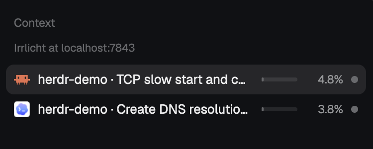

# Irrlicht for Herdr.app

A [Herdr.app](https://herdr.dev) mod that lists Herdr's agents the way the
Irrlicht menu bar app lists sessions. Agents are grouped by project. Each row
shows the agent's Irrlicht state, its model, and how full its context window
is, for example `4.6%` beside a bar coloured by pressure. Clicking a row
focuses that agent's pane.



It is read-only. It reads the local Irrlicht daemon (`GET /api/v1/sessions`,
the endpoint the dashboard uses) and changes nothing in Irrlicht or Herdr.

This is for `Herdr.app` (`~/.config/herdr-app`), not the older terminal `herdr`
(`~/.config/herdr`).

## Install

You need Irrlicht running (the menu bar app or `irrlichd`) and Herdr.app.

Copy this folder, or link it from a clone, to `~/.config/herdr-app/mods/irrlicht`:

```sh
ln -s "$PWD/platforms/herdr/mods/irrlicht" ~/.config/herdr-app/mods/irrlicht
herdr-app check ~/.config/herdr-app/mods/irrlicht
```

Herdr can also install it from this folder's GitHub URL: give your Herdr agent
the link and ask it to add the mod.

## Show it

- As a floating window, over every tab. Run the same command again to close it:

  ```sh
  herdr-app do mod.open --name irrlicht
  ```

- As a pane beside the terminals of the current tab:

  ```sh
  herdr-app do pane.split --direction right --mod irrlicht
  ```

`mod.json` asks for a place on the right, but Herdr 0.1.16 did not dock the
mod into its shipped `main` layout by itself: not for a linked folder, not for
a copied one, and not after a restart. Both commands above were tested on
0.1.16.

To focus an agent from the keyboard, `irrlicht.focus-<n>` runs the click of
row `n` as the panel draws it. Rows are counted from 1 across all groups, and
each row shows its number. Bind it in `keys.json`, or run it from a shell:

```sh
herdr-app do irrlicht.focus-2
```

## What the panel shows

It follows the macOS app's session list (`SessionListView`, `GroupView`,
`SessionRowView` and `SessionStateIcon` in `platforms/macos/Irrlicht/Views`).
The hues are Irrlicht's, from
`tools/irrlicht-design-system/colors_and_type.css`. Backgrounds, text, borders
and hover come from Herdr's theme, so the panel follows a light or a dark Herdr
theme.

- **Header:** `Irrlicht`, then the state icons of up to three rows (or a count
  such as `5 agents`), and a connection dot on the right. The dot is green when
  the daemon answers, orange while the panel first looks for it, and red
  otherwise. Hover over it to see which daemon the panel reads.
- **A line under the header** appears only while the daemon is not answering.
  It says *not reachable* when nothing answers, *not answering* when a request
  has hung for 10 seconds, *sent an unexpected answer* when something else
  answers on that port, and *panel error* when the mod itself failed. The
  last two sit on a red wash. A broken panel never looks like a stopped
  daemon.
- **Groups:** one per project, named as the daemon groups it (the session's
  `project_name`, else `unknown`; a session an orchestrator such as Gas Town
  claimed is in that orchestrator's group, marked ⛽). Each has a fold chevron
  and a count such as `2 sessions`. A group keeps the place where it first
  appeared for as long as the panel is open. The macOS app remembers that
  order across restarts and lets you move groups; this panel does neither.
  Rows within a group are in the order the daemon lists them. Agents
  that no Irrlicht session matched come last, in a group named `Other agents`,
  in Herdr's order. Before the daemon answers, every agent is in that group.
- **Rows:** see the next table. A row that no session matched shows its state
  icon, number, title and program icon only.

| The row shows | Where it comes from |
|---|---|
| State icon | The session's state, drawn as the macOS app draws it (see below). |
| Number | The row's place in the panel, which `focus-<n>` uses. |
| Purple badge with a count | Subagents working or waiting, from the daemon's subagent summary. |
| Title | The agent's terminal title, else its tab's name. |
| Model, e.g. `opus-5.5` | The session's model, shortened as the macOS app shortens it. |
| Program icon | Herdr's icon for the agent. |
| Bar, e.g. `46.4K`, and `4.6%` | The context fill. The bar holds the token count, and the bar and the percentage take the pressure hue: green below 60%, orange from 60%, red from 80%, dark red from 90%. |
| `31.0K / ?` and `—` | Irrlicht could not resolve the context window. The panel shows the token count, never a misleading `0%`. |
| Red line | The session failed: the agent's message, else the kind of failure. |
| Orange pill | The session is waiting, and this is its question. |
| `Switch to a fresh session soon` | The context is 80% full or more and the session is still going. |

The state icons and their hues:

| State | Icon | Hue |
|---|---|---|
| `working` | a solid dot that slowly pulses | `#8B5CF6` purple |
| `waiting` | two pause bars | `#FF9500` orange |
| `ready` | a disc with a check | `#34C759` green |
| `error` | a disc with an exclamation mark | `#FF3B30` red |
| unknown | a ring with a question mark | `#8E8E93` grey |

An agent that no Irrlicht session matched gets a state from its Herdr status:

| Herdr status | Shown as |
|---|---|
| `working` | `working` |
| `blocked` (needs you) | `waiting` |
| `done` | `ready` |
| `idle` | `ready` |
| anything else | unknown |

Herdr has no failure status, so these rows are never shown as `error`.

Hover over a row to see its space and title, its state, the exact figure,
the model, its branch, and how the session was matched. The cost display is
off by default in the macOS app, so it is not shown here either.

## Which daemon it reads

It uses the same address order as Irrlicht's other clients
(`daemonaddr.ClientURL`):

1. `IRRLICHT_BIND_ADDR`, if Herdr.app's own environment has it.
2. The address the daemon published in `$IRRLICHT_HOME/irrlichd.addr`, else in
   `~/.local/share/irrlicht/irrlichd.addr`. A symlink is not read.
3. `localhost:7837`.

Herdr's own docs say a Finder launch loads the login shell's `PATH`. Whether
other variables from a shell profile reach Herdr.app was not checked, so expect
the address file and the default port to be what applies. The mod reads the
environment once, when it starts.

## How agents are matched to sessions

- **By pid first.** This uses the pid of the terminal's foreground process,
  then the pid of the terminal itself. Claude Code 2.1.330 matched this way.
- **Then by agent and folder.** This needs Herdr's agent name (`codex`) and the
  folder to be shared by exactly one Herdr agent and exactly one Irrlicht
  session. Codex 0.163.0 installed with npm matched this way. Herdr reports its
  `node` launcher as the foreground process, and Irrlicht reports the native
  binary that `node` starts, so the pids never match.

Two sessions of the same agent in one folder therefore get no gauge, unless
their pids match. They never trade numbers. Sessions Irrlicht sees outside
Herdr are not listed. An agent on another machine (`vps/t7`) gets no gauge:
the daemon only sees this machine's sessions.

## What it runs

Herdr asks you to check this before you add a mod:

- **Network:** one `GET http://localhost:<port>/api/v1/sessions` every 3
  seconds.
- **Programs:** `/usr/bin/printenv` twice at start, for the two environment
  variables, because a mod has no `process.env`. Also `/bin/sh -c '[ -f "$1" ]
  && [ ! -L "$1" ]'` on the address file, because a mod has no `lstat`. This
  test runs when the panel starts, and at most every 30 seconds while the
  daemon does not answer.
- **Files:** it reads only the address file above, and draws the icons in
  its own `icons/` folder.

## Develop

The decisions live in `lib/`, which imports nothing from Herdr. The tests in
`test/` run under vitest:

```sh
cd platforms/herdr && npm ci --ignore-scripts && npm test
```

- `test/main.render.test.js` draws `main.js` against recording stand-ins for
  Herdr's modules (`test/stubs/`, aliased in `vitest.config.js`). It checks
  what is asked for (texts, hues, icons, click handlers), not the layout.
- `test/palette.parity.test.js` reads
  `tools/irrlicht-design-system/colors_and_type.css` and checks every hue in
  `lib/palette.js` against it. It also reads `core/domain/session/session.go`
  and checks that the state maps name every state the daemon declares.
- `test/address.parity.test.js` runs the Claude Code panel's copy of the
  address ladder (`platforms/claude-code/lib`) through the same table of Go's
  answers.
- The `*.mutation.test.js` files run those contracts against committed broken
  copies of `lib/` and expect them to fail.

The parity tests read files elsewhere in this repository, so they run only
here. `main.js` is the only file that uses Herdr's runtime. Check it with
`herdr-app check`, which needs Herdr.app and is not part of CI. Herdr writes
`jsconfig.json` and `gpui-kit.d.ts` into a mod folder it loads, and
`.gitignore` keeps them out of the repository. In one test on Herdr 0.1.16, an
open panel window kept running the old code after a save in the linked folder.
Closing and reopening it (`mod.open` twice) loaded the new code.
