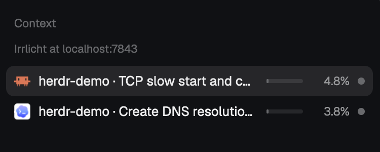

# Irrlicht

A panel that lists Herdr's agents the way the
[Irrlicht](https://github.com/ingo-eichhorst/Irrlicht) menu bar app lists
sessions: grouped by project, each with its Irrlicht state, model and context
fill, as measured by the local Irrlicht daemon. A Claude Code row reads
`opus-5.5` with a green `4.6%` bar. Clicking a row focuses that agent.

## What you see

Hues are Irrlicht's (`lib/palette.js`, copied from
`tools/irrlicht-design-system/colors_and_type.css`). Every neutral is Herdr's
`theme()`: `chrome` behind the column, `foreground`, `muted` and `dim` for text,
`border` for the divider, `hover` and `selected` for rows.

- **Header**, 36px tall, 12px padding at the sides:
  - `Irrlicht` (13px, semibold, `foreground`);
  - a `dim` em dash and the state icons of up to three rows, or a count such
    as `5 agents` in Geist Mono;
  - on the right, a 6px connection dot: `--ws-connected` green when the daemon
    answers, `--waiting` orange while the panel first looks for it, and
    `--ws-disconnected` red otherwise. Its tooltip is the status line below.
- **Status line**, 11px, only while the daemon is not answering. It reads
  `Irrlicht daemon not reachable at localhost:<port>` or
  `Irrlicht daemon at localhost:<port> is not answering` in `dim`,
  `Looking for the Irrlicht daemon…` before the first answer, or, on a 12%
  `--error` wash in `foreground`, `Irrlicht at localhost:<port> sent an
  unexpected answer` and `Irrlicht panel error: <message>`. When the daemon
  answers it is the dot's tooltip: `Irrlicht at localhost:<port>`.
- A 1px `border` divider.
- **Groups**, as GroupView: a 10px chevron (down when open, right when folded;
  a click folds), `⛽` on a Gas Town group, the name in Geist Mono 11.5px
  semibold `foreground`, and the count (`1 session`, `2 sessions`) in `dim` on
  the right. The trailing group of unmatched agents is `Other agents` with
  `1 agent`, `2 agents`.
- **Rows**, indented 8px under their header, 10px padding, 6px corners;
  `selected` marks the focused agent and `hover` shows on hover. The first line
  is 18px tall, left to right:
  - the state icon, 12px (below);
  - the row number in Geist Mono 9.5px `dim`, right-aligned in 12px;
  - a 14px `--working` disc with the active subagent count in white bold 9px,
    when there are any;
  - the title, 12.5px `foreground`, truncated;
  - the short model name in Geist Mono 10.5px `muted`, at most 96px;
  - the program icon, 12px.

  A matched row with a figure has a second line, 15px tall, starting under the
  title (36px in):
  - a bar filling the space, 13px tall with 3px corners: the track is
    `foreground` at 8%, the fill the pressure hue, and the token count (`46.4K`)
    sits inside on the right in Geist Mono 8.5px `muted`;
  - the percentage (`4.6%`) in Geist Mono 10px in the pressure hue, 38px wide.

  With the window unknown, the bar's place holds `31.0K / ?` and the
  percentage's a `—`, both `muted`.

  Under that, a note per condition, each 10.5px `foreground` text on a 12% wash
  of its hue with 4px corners:
  - failed session: a `--error` warning triangle and the failure's message;
  - waiting session with a question: the question on a `--waiting` wash, up to
    three lines;
  - 80% or more of the context and still working or waiting: a
    `--pressure-high` triangle and `Switch to a fresh session soon`.
- With no agents, the column reads "No agents yet. Agents show up here when
  they report their status to Herdr."

The state icons follow SessionStateIcon, 12px, one per line:

- `working`: a `--working` dot whose opacity swings between 1 and 0.55 every
  1.4 s (`.loop`, native).
- `waiting`: two `--waiting` pause bars.
- `ready`: a `--ready` disc with the check cut out (`icons/state-ready.svg`).
- `error`: a `--error` disc with the mark cut out (`icons/state-error.svg`).
- unknown: a `--cancelled` grey ring with a question mark
  (`icons/state-unknown.svg`).

## How it behaves

- **Matched state:** a row matched to a session shows that session's state.
- **Unmatched state:** Herdr's status, one rule per line:
  - `working` shows as `working`;
  - `blocked` (Herdr's "needs you") shows as `waiting`;
  - `done` shows as `ready`;
  - `idle` shows as `ready`;
  - anything else shows as unknown.

  Herdr has no failure status, so an unmatched row never shows `error`.
- **Pressure hue:** Irrlicht's `pressure_level` picks it, as the macOS app's
  `contextPressureColor`. The daemon sets the level from the fill
  (`core/pkg/tailer/tailer_metrics.go`): `safe` (below 60%) is
  `--pressure-low`, `caution` (60%) `--pressure-medium`, `warning` (80%)
  `--pressure-high` and `critical` (90%) `--pressure-critical`. The bar and
  the percentage share it.
- **Order:** a group keeps the place where it first appeared while the panel
  is open (SessionManager.orderedGroups), and a group that leaves and comes
  back takes that place again. Rows in a group are in the daemon's payload
  order (GroupView). Unmatched agents come last, in Herdr's order.
- **Clicking a row** runs `pane.focus {terminal: <address>}`. The mod command
  `irrlicht.focus-<n>` does the same for row n as drawn, counting from 1
  across groups, folded ones included.
- **Clicking a group header** folds or unfolds it. Folding is kept per panel
  copy and does not renumber rows.
- **Hover** on a row shows a tooltip such as
  `2. herdr-demo · TCP slow start notes · Waiting for input · 4.6% of 1.0M
  context, safe · claude-opus-5-5 · matched by pid`. The state icon's tooltip
  is the state (`Ready (Herdr: done)` for an unmatched row), and the badge's
  is `3 active subagents`.
- **Polling:** every 3 s it GETs `/api/v1/sessions` and redraws only when
  something drawn changed: the status line, a group, its name, count or place,
  or any field of a row. It sends one request at a time. Herdr's `fetch` has
  no timeout, so a request still unanswered after 10 s turns the dot red, adds
  the "not answering" line, and moves every agent to `Other agents`.

## Built from

- **One mod:** `mods/irrlicht/`. `mod.json` sets `place: right`, size 320, and an
  `overlay` of kind `window` at 380×240, which `mod.open` uses.
- **Herdr functions:** `agents()`, `terminals()` (`pid`, `foreground.pid`,
  `foreground.cwd`), `theme()`, `run("pane.focus")`, `exec`, `home()`,
  `readTextFile`, `checking()`, `nextCommand()`, and the global `fetch`.
- **Programs:** `/usr/bin/printenv IRRLICHT_BIND_ADDR` and
  `/usr/bin/printenv IRRLICHT_HOME`, run once each, because a mod has no
  `process.env`. Also `/bin/sh -c '[ -f "$1" ] && [ ! -L "$1" ]'` on the address
  file, because a mod has no `lstat`.
- **Network:** `http://localhost:<port>/api/v1/sessions` only.
- **Address order**, as Irrlicht's `daemonaddr.ClientURL`:
  1. `IRRLICHT_BIND_ADDR` with a port from 1 to 65535.
  2. The first 64 bytes of `$IRRLICHT_HOME/irrlichd.addr`, else of
     `~/.local/share/irrlicht/irrlichd.addr`, trimmed. It must be a regular
     file and not a symlink.
  3. Port 7837.

  The address is kept while the daemon answers. Once a poll has failed, it
  is looked up again at most every 30 s.
- **Matching an agent to a session:**
  1. A session whose `pid` equals the terminal's `foreground.pid`, else the
     terminal's `pid`. Two sessions on one pid match neither.
  2. Otherwise, the session whose `adapter` equals the agent's `app` and whose
     `cwd` equals `foreground.cwd`. This applies only when exactly one agent and
     exactly one session share that pair, and no row already holds that
     session.

  Child sessions (subagents) and agents on other machines (`vps/t7`) are
  never matched.
- **Icons:** `icons/` holds the state glyphs, the warning triangle and the
  chevrons, drawn with `svg("mods/irrlicht/icons/…")` and tinted by gpui.
- **Code layout:** the decisions are in `lib/` (address, sessions, match,
  gauge, notes, states, palette, layout, poll, rows), with no Herdr imports,
  and are tested with vitest. `main.js` reads Herdr and draws;
  `test/main.render.test.js` draws it against stand-ins for Herdr's modules.

## Watch out

- The mod's runtime has no `TextEncoder`, `process.env` or `lstat`, and
  `readTextFile` follows symlinks. All four were measured in a live mod.
- `foreground.cwd` is the resolved path (`/private/tmp/...`) and matches
  Irrlicht's `cwd`. The terminal's own `cwd` is the path as typed (`/tmp/...`)
  and does not.
- Codex installed with npm runs as `node` → native binary. Herdr's foreground
  pid is the `node` process and Irrlicht's pid is the binary, so Codex is
  matched by folder only.
- A Herdr.app started from inside a Claude Code session passes
  `CLAUDE_CODE_CHILD_SESSION` to every terminal. Claude Code then saves no
  transcript, and Irrlicht cannot see that session.
- Herdr 0.1.16 did not dock the mod by `place` into the shipped `main` layout.
  Open it with `mod.open` or `pane.split {mod: "irrlicht"}`.
- `herdr-app check` renders the first frame only. The poll, the address
  lookup, the matching and the drawing of rows run later. The vitest suite
  covers them, and `test/main.render.test.js` checks what the rows ask gpui
  to draw, not how it looks.
- The hues are fixed, as in the macOS app, while the theme changes around
  them. On a dark theme they stand out, the dark red of a critical fill
  least. On a light one the green and orange are faint, as in the macOS app's
  light appearance, and fainter still on a grey ground such as the `win98`
  theme's. That is why the notes' words use `foreground` and only their
  washes and triangles take the hue.

## Done when

- `herdr-app check mods/irrlicht` passes.
- With two agents of different kinds running in Herdr, each row's percentage
  equals the daemon's `context_utilization_percentage` for that session, to
  one decimal.
- Each matched row's state icon and model agree with the daemon's `state`
  and `metrics.model_name` for that session, and rows sit under their
  session's project.
- Stopping the daemon turns the dot red and shows "not reachable", and every
  row moves to `Other agents` with its Herdr status, while the rows stay.
  Starting it again restores the groups within one poll.
- Pausing the daemon (`kill -STOP`) shows "not answering" within about 13 s,
  and resuming it (`kill -CONT`) restores the groups.
- Clicking a row, or running `herdr-app do irrlicht.focus-<n>`, focuses the
  agent drawn as row n.
