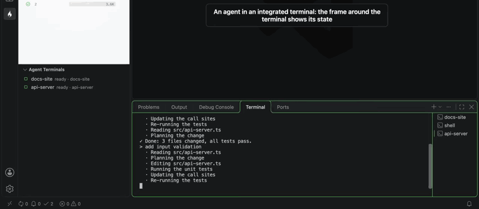

# Irrlicht for VS Code

Shows what your coding agents are doing without leaving the editor.

- **Dashboard in a panel.** Run **Irrlicht: Open Panel** from the Command Palette, or open the Irrlicht view in the activity bar. Both host the Irrlicht dashboard.
- **Status bar counts.** One count per session state: working, waiting, ready and error. The error count only shows when it is non-zero. Click it to open the panel. When the daemon is not running, the status bar says so and the extension reconnects automatically.
- **Terminal frame.** The frame around the terminal area takes the state colour of the agent in the active terminal: purple for working, orange for waiting, green for ready, red for error. Switch to another agent terminal and the frame follows it; switch to a plain terminal and your own colours come back. See [Terminal frame](#terminal-frame).
- **Agent Terminals view.** Lists every integrated terminal that hosts an agent session, with its state and project. Click a row to show that terminal. The view badge counts the terminals that are waiting for you.
- **Click to focus.** Click a row in the dashboard to bring that session's terminal to the front.

## Requirements

The Irrlicht daemon must be running locally: either the macOS app or the `--daemon-only` curl install.

The terminal frame, the Agent Terminals view and click-to-focus also need the daemon's **Terminal focus → Capture terminal identity** permission (answer it in the dashboard's permission wizard). Without it the daemon does not record which TTY a session runs in, so no terminal pairs; the dashboard and the status bar work either way.

| Setting | Default | Notes |
| --- | --- | --- |
| `irrlicht.daemonUrl` | `http://127.0.0.1:7837` | Machine-scoped. Loopback http(s) only; any other value falls back to the default. |
| `irrlicht.terminalFrame` | `border` | `off`, `border`, or `border-and-tint`. See [Terminal frame](#terminal-frame). |

## Terminal frame

VS Code's extension API has no way to colour or outline one terminal, so the extension does what [Peacock](https://marketplace.visualstudio.com/items?itemName=johnpapa.vscode-peacock) does for whole windows: it writes colour keys into `workbench.colorCustomizations` in the **workspace settings**: the folder's `.vscode/settings.json`, or the `.code-workspace` file of a multi-root workspace.

- **One colour per window.** The frame follows the active terminal (the one focused last) and the agent session paired with it. Two terminals shown side by side, in split panes or in two editor groups, share one frame colour: the active one's.
- **What gets coloured.** With the default `border`, a terminal in the panel gets `modernPanel.border` (the outline around the panel in VS Code's modern layout), plus `panel.border`, `panelTitle.activeBorder`, `terminal.tab.activeBorder` and `terminal.border` (the panel's top edge, the active-tab underline and the split-pane rules in the classic layout). A terminal opened in the editor area gets `editor.border`, `tab.activeBorderTop`, `tab.unfocusedActiveBorderTop` and `editorGroup.border` instead. `border-and-tint` also tints `terminal.background` (and `panel.background` for the panel) towards the state colour.
- **Your colours come back.** The extension remembers the values you had for those keys and puts them back when the active terminal has no agent, when no terminal is active, and when you set `irrlicht.terminalFrame` to `off`. Every other key in `workbench.colorCustomizations`, including theme-scoped blocks such as `"[Default Dark Modern]": {...}`, keeps its value. VS Code rewrites the whole `workbench.colorCustomizations` value when it writes, though, so comments inside that block are lost. If you edit one of those keys while a frame is shown, your edit is kept and is what comes back.
- **Closing the window keeps the frame on disk.** VS Code disconnects an extension from the window before it shuts the extension down, so the extension cannot write the restore when the window closes or reloads. The frame colours stay in the workspace settings file until that folder or workspace is opened again; the extension then restores your values within about a second of starting.
- **Before you uninstall,** set `irrlicht.terminalFrame` to `off` in your user settings, and open any folder that was closed while it showed a frame, so the extension can put your values back. VS Code keeps an uninstalled extension running until the next restart and then no longer runs it, so it gets no chance to clean up afterwards.
- **No folder, no frame.** With no folder or workspace open there is no workspace settings file, so the frame stays off in that window. It never writes your user settings.
- **Mind `git status`.** The colours land in the workspace settings file, so a repository that commits that file shows it as changed while a frame is up, and an agent working in that repository can see the change too. In a folder without `.vscode/settings.json` the first frame creates the file, and after the restore VS Code leaves it behind as `{}`. Set `irrlicht.terminalFrame` to `off` in such repositories, or keep the file out of version control.
- **Side effects.** In the modern layout, `modernPanel.border` also outlines the active tab of the side bars, and with `border-and-tint`, `panel.background` also tints the Problems and Output views.
- **Tint base.** The extension cannot read the theme's real terminal background, so the tint is mixed into a fixed dark (`#181818`) or light (`#F8F8F8`) background, the panel background of Dark Modern and Light Modern and within a few shades of VS Code's 2026 default themes. With other themes the tinted terminal looks different from the theme's own. That is why the tint is not the default.
- **Precedence.** A theme-scoped value you set for one of those keys (inside `"[Theme Name]": {...}`) wins over the frame. A top-level `irrlicht.state.<state>` entry in `workbench.colorCustomizations` changes the frame colour too.

## Install

Marketplace publishing is not set up yet; sideload the `.vsix`:

- `code --install-extension irrlicht-vscode-<version>.vsix`, or
- Extensions view, then `...`, then **Install from VSIX...**

Build the `.vsix` from a repository checkout with `tools/build-release.sh --vsix-only`. The file lands in `.build/`.

## Limitations

- VS Code's extension API cannot recolour an existing terminal tab: `Terminal` has no setter for it, and the change-colour command only opens a picker. That is why the state colour is painted as a frame through workspace colour customizations, one colour per window, and why the Agent Terminals view lists every agent terminal with its state.
- A terminal counts as being in the editor area when an editor tab carries its name. Two terminals with the same name, one in the panel and one in the editor area, can get the frame on the wrong one; give agent terminals distinct names.
- In the classic layout (`workbench.experimental.modernUI` off) the panel has no outline, so `border` shows as the panel's top edge, the active-tab underline and the tab-list rule. `border-and-tint` reads more clearly there.
- A terminal is paired with a session by joining the terminal's shell TTY with the session's TTY. An agent running inside tmux does not pair (its TTY is the tmux pane's, not the terminal's). Under herdr the daemon records the TTY of the attached herdr client, so its sessions pair with the terminal running the herdr client, and that terminal's row and frame follow the most recently updated pane. That herdr behaviour is not verified live.
- Raising another VS Code window on click needs the Irrlicht macOS app, because VS Code has no window-raise API.
- The embedded dashboard follows the operating system's light/dark appearance (or its own theme toggle), not the VS Code colour theme.
- Local windows only: Remote-SSH, WSL and Codespaces are not supported.
- Cursor and Windsurf (VS Code forks) are untested.

## Development

From `platforms/vscode`:

- `npm ci` to install.
- `npm test` type-checks (`tsc --noEmit`), validates the manifest (`vsce ls`, which also enforces `@types/vscode` <= `engines.vscode`), runs the frame-src mutation self-test (`test/e2e/frame-src-mutation_test.sh`) and the unit tests.
- `npm run test:e2e` downloads VS Code and runs the end-to-end tests locally. On macOS the runner passes `--use-mock-keychain --use-inmemory-secretstorage` and a short `--user-data-dir`. It opens a throwaway copy of `test/e2e/workspace` (step 4g writes the terminal frame into that copy's `.vscode/settings.json`) and deletes it afterwards.
- `npm run test:e2e:mutation` re-runs the frame-src mutation: it swaps the iframe CSP for `'none'` and passes only if the e2e fails at step 4b (needs a clean git tree).
- `npm run build` bundles `dist/extension.js`.
